<p align="center">
  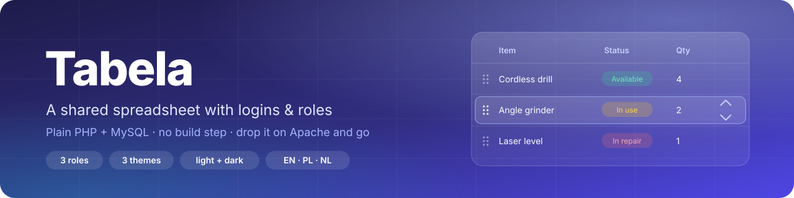
</p>

<p align="center">
  
  
  
  
  
</p>

<p align="center">
  <b>A shared, editable table for your team, with logins, roles, daily snapshots and a polished UI.</b><br>
  Pure LAMP stack: <b>no Node.js, no npm, no Composer, no build step</b>. Copy the files to Apache and you're done.
</p>

<p align="center">
  <a href="#-quick-start">Quick start</a> ·
  <a href="#-features">Features</a> ·
  <a href="#-screenshots">Screenshots</a> ·
  <a href="#-installation">Installation</a> ·
  <a href="#-security">Security</a>
</p>

<br>

<picture>
  <source media="(prefers-color-scheme: dark)" srcset="screenshots/table-dark.png">
  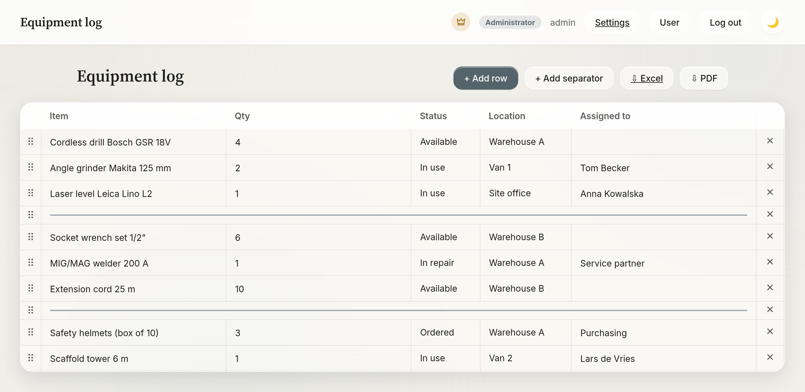
</picture>

---

## ✨ Features

<table>
  <tr>
    <td width="50%" valign="top">
      <h4>👥 Three roles</h4>
      <b>Admin</b> manages columns, users and settings. <b>Editor</b> adds, edits and reorders rows.
      <b>Viewer</b> gets read-only access. Every permission is enforced server-side in PHP,
      not just hidden in the UI.
    </td>
    <td width="50%" valign="top">
      <h4>🧩 Typed columns</h4>
      <b>Text</b>, <b>number</b> (validated) and <b>dropdown</b> columns with a fixed list of
      options. Add full-width <b>separator rows</b> to group your data.
    </td>
  </tr>
  <tr>
    <td valign="top">
      <h4>↕️ Drag &amp; drop</h4>
      Grab any row by its handle and drop it where it belongs. Works with mouse and touch,
      saves instantly and stays safe when two people edit at once.
    </td>
    <td valign="top">
      <h4>🗓️ Automatic daily archive</h4>
      A snapshot of the whole table is saved every day at 8:00 PM, with <b>no cron needed</b>.
      Admins can browse, preview and delete past days.
    </td>
  </tr>
  <tr>
    <td valign="top">
      <h4>🎨 Themes + dark mode</h4>
      Three visual styles (<b>Liquid</b> glassmorphism, flat <b>Modern</b> and the
      <b>Esbro</b> brand theme), each in light and dark. The choice is remembered per browser.
    </td>
    <td valign="top">
      <h4>🌍 Three languages</h4>
      English, Polish and Dutch, switchable per user at any time.
    </td>
  </tr>
  <tr>
    <td valign="top">
      <h4>📤 Export</h4>
      Download the table as an Excel-friendly CSV (UTF-8, formula-safe) or print a clean PDF.
    </td>
    <td valign="top">
      <h4>🔗 Public read-only link</h4>
      Optionally let anyone with the link view the table without logging in. Editing
      still requires an account.
    </td>
  </tr>
</table>

---

## 📸 Screenshots

### Reorder rows by dragging

<p align="center">
  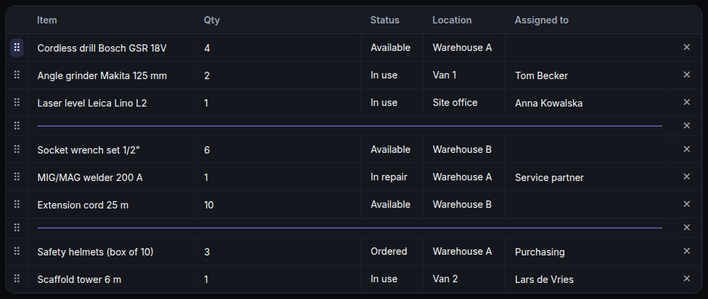
</p>

### Pick your look

| | ☀️ Light | 🌙 Dark |
| --- | --- | --- |
| **Liquid** | 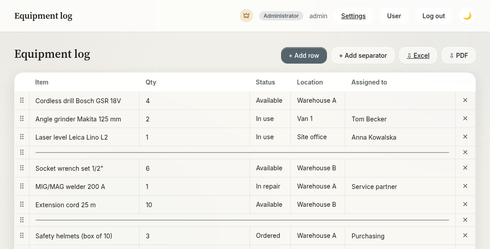 | 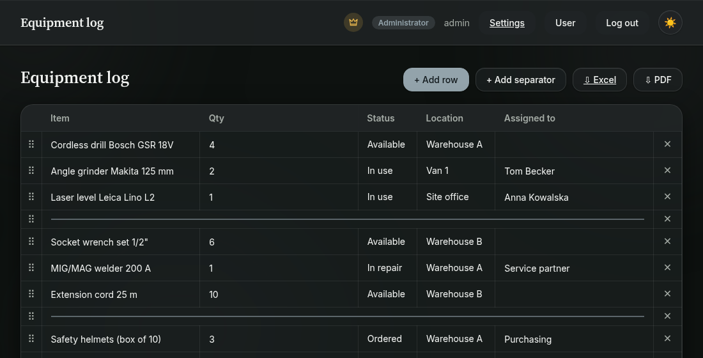 |
| **Modern** | 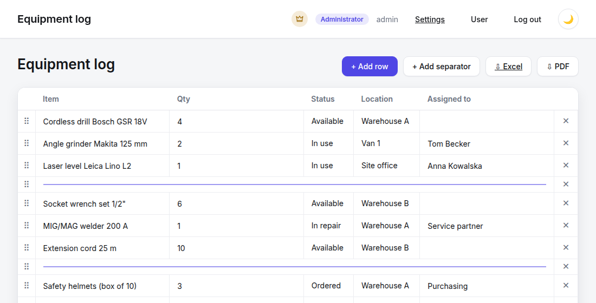 | 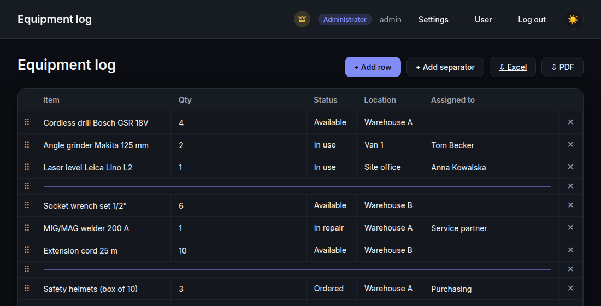 |

### Admin panel

| Columns & settings | Users & roles |
| --- | --- |
| 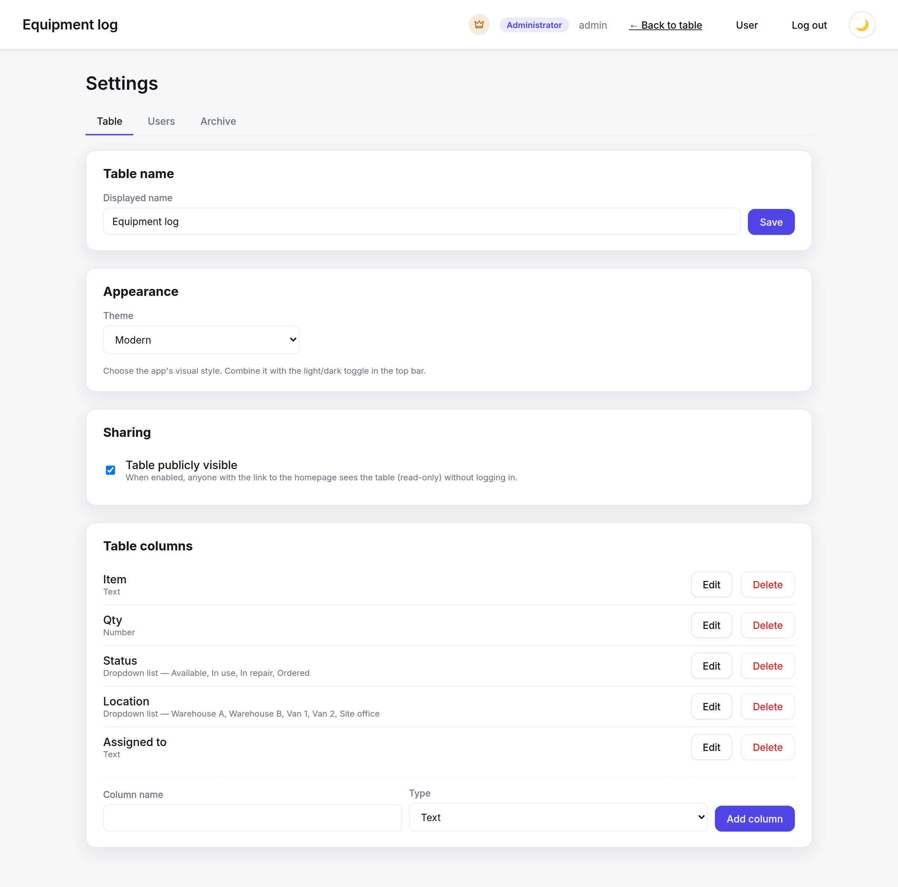 | 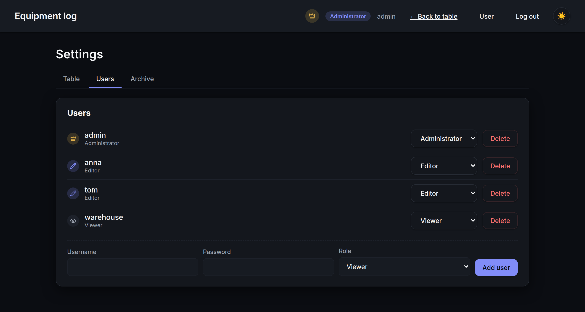 |

<p align="center">
  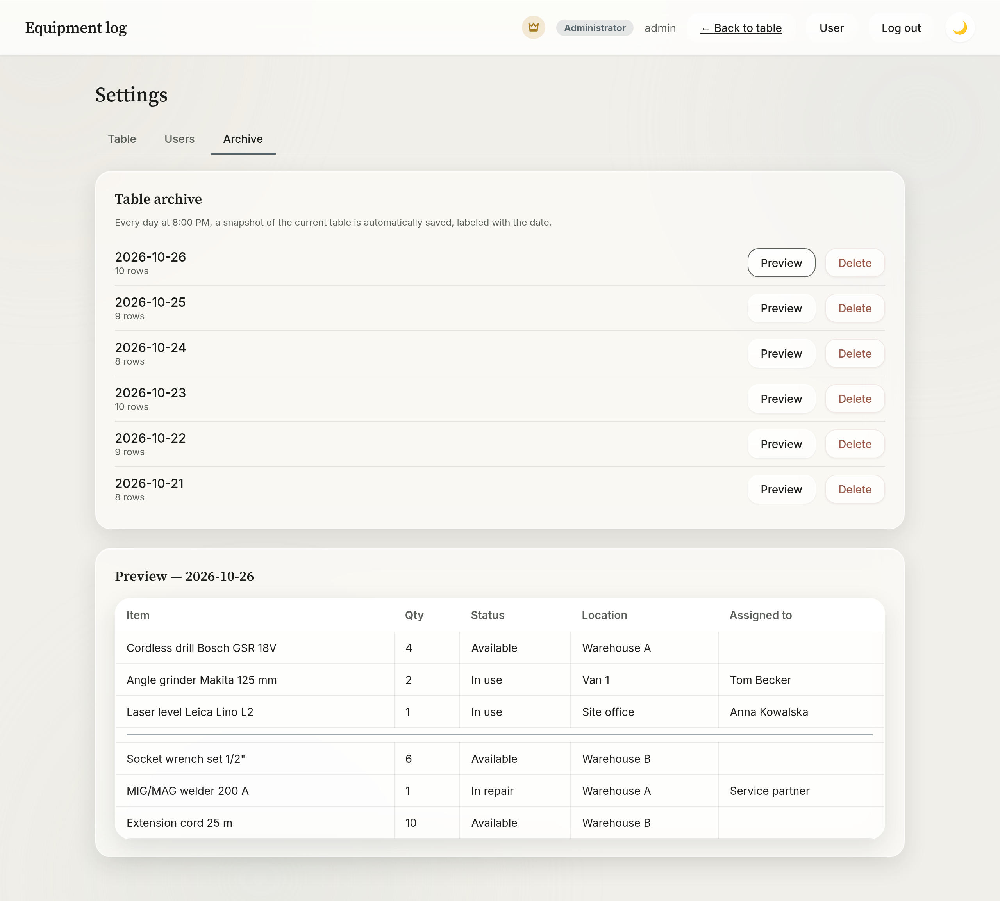<br>
  <sub>Daily archive: every day's snapshot, one click to preview</sub>
</p>

### Login

| Liquid, light | Modern, dark |
| --- | --- |
| 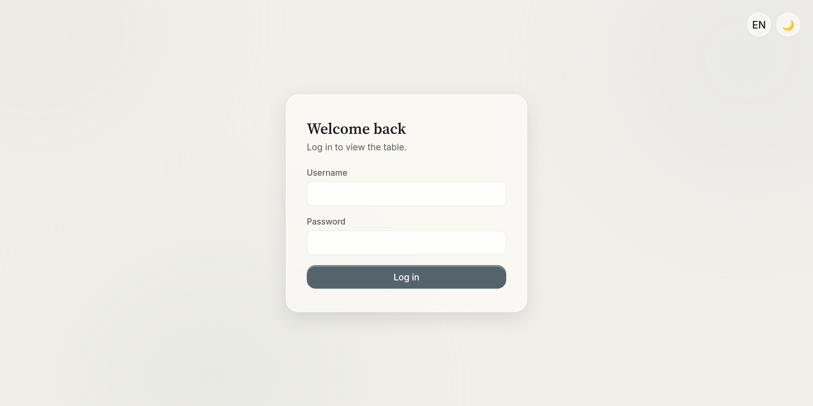 | 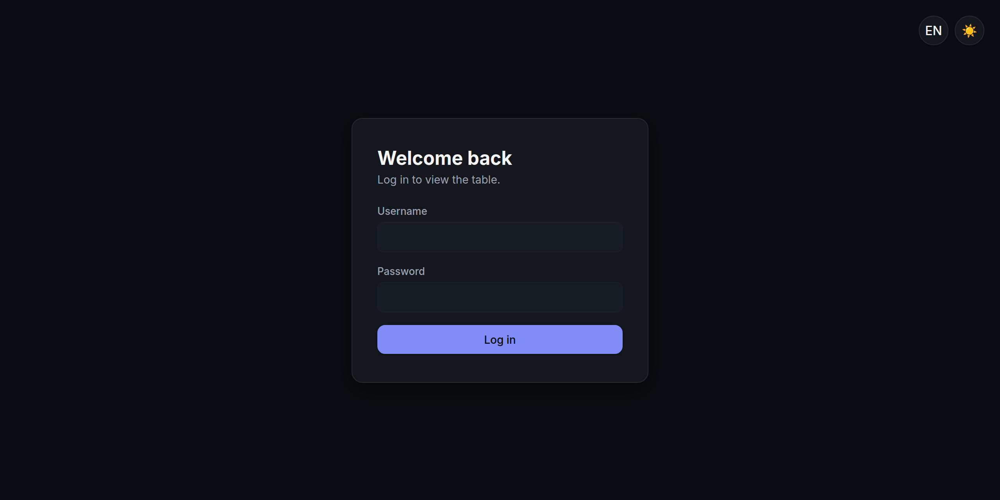 |

---

## 🚀 Quick start

Already have Apache, PHP and MySQL? Five steps:

```bash
cd /var/www/html
sudo git clone https://github.com/grubassound/tabela-app.git tabela-app
cd tabela-app
sudo cp config.php.example config.php && sudo nano config.php   # database credentials
sudo chown -R www-data:www-data .
```

Then open `http://YOUR-SERVER/tabela-app/login.html` and log in as **`admin` / `admin123`**.
The database tables are created automatically on the first request.

> [!WARNING]
> Change the default `admin123` password right after your first login (**User** button, top right).

Need the full walkthrough? See [Installation](#-installation) below.

---

## 🧱 Tech stack

| Layer | What's used |
| --- | --- |
| Backend | Plain PHP 8 (no framework, no Composer), PDO with prepared statements |
| Database | MySQL / MariaDB, with tables created and migrated automatically |
| Auth | Native PHP sessions, `password_hash()` / bcrypt |
| Frontend | Plain HTML, CSS and JavaScript, no framework and no bundler |
| Web server | Apache with `mod_php` or `php-fpm` |

---

## 📦 Installation

<details>
<summary><b>1. Server requirements</b></summary>

```bash
sudo apt update
sudo apt install apache2 php libapache2-mod-php php-mysql
```

Check that it's working:

```bash
php -v
apache2 -v
```

`php-mysql` is the PDO/mysqli extension. Without it PHP can't connect to your database.

</details>

<details>
<summary><b>2. MySQL database</b></summary>

```bash
sudo mysql -u root -p
```

```sql
CREATE DATABASE tabela_app CHARACTER SET utf8mb4 COLLATE utf8mb4_unicode_ci;
CREATE USER 'tabela_user'@'localhost' IDENTIFIED BY 'PUT-A-STRONG-PASSWORD-HERE';
GRANT ALL PRIVILEGES ON tabela_app.* TO 'tabela_user'@'localhost';
FLUSH PRIVILEGES;
EXIT;
```

The app creates all its tables automatically on the first request, so there is nothing to import.

</details>

<details>
<summary><b>3. Files and configuration</b></summary>

```bash
cd /var/www/html
sudo git clone https://github.com/grubassound/tabela-app.git tabela-app
cd tabela-app
sudo cp config.php.example config.php
sudo nano config.php
```

Fill in your database credentials (same as in step 2):

```php
define('DB_HOST', 'localhost');
define('DB_PORT', '3306');
define('DB_NAME', 'tabela_app');
define('DB_USER', 'tabela_user');
define('DB_PASSWORD', 'PUT-A-STRONG-PASSWORD-HERE');
```

Optional settings (the defaults work as-is):

```php
define('APP_TIMEZONE', 'Europe/Warsaw'); // time zone used for the daily archive
define('ARCHIVE_HOUR', 20);              // hour from which the daily snapshot is taken
```

Set the file owner to the Apache user:

```bash
sudo chown -R www-data:www-data /var/www/html/tabela-app
```

</details>

<details>
<summary><b>4. Apache configuration</b></summary>

#### a) Enable `.htaccess` (important for security)

By default Apache **ignores `.htaccess` files**. The ones in this project block access to
`config.php`, `includes/`, `cli/` and hidden files such as `.git`, and add security headers.
Add this to `/etc/apache2/apache2.conf` (or your VirtualHost):

```apache
<Directory /var/www/html/tabela-app>
    AllowOverride All
    Require all granted
</Directory>
```

```bash
sudo a2enmod headers     # used for the security headers
sudo systemctl restart apache2
```

#### b) PHP module (usually already enabled by `libapache2-mod-php`)

```bash
sudo a2enmod php8.3      # version depends on your PHP install
sudo systemctl restart apache2
```

#### c) Own domain (VirtualHost)

Create `/etc/apache2/sites-available/tabela-app.conf`:

```apache
<VirtualHost *:80>
    ServerName tabela.yourdomain.com
    DocumentRoot /var/www/html/tabela-app

    <Directory /var/www/html/tabela-app>
        AllowOverride All
        Require all granted
    </Directory>

    ErrorLog ${APACHE_LOG_DIR}/tabela-app-error.log
    CustomLog ${APACHE_LOG_DIR}/tabela-app-access.log combined
</VirtualHost>
```

```bash
sudo a2ensite tabela-app.conf
sudo systemctl reload apache2
```

#### d) IP-only access (no domain)

Nothing extra needed. With `AllowOverride All` from step (a) the app is reachable at
`http://YOUR-SERVER-IP/tabela-app/login.html`.

</details>

<details>
<summary><b>5. First run</b></summary>

Open `login.html` in your browser. The default admin account is created automatically:

- **username:** `admin`
- **password:** `admin123`

⚠️ **Change this password right after your first login** with the **User** button in the top right corner.

</details>

---

## 🗓️ Daily archive

A snapshot of the whole table is saved automatically once a day, with **no setup needed**:

- the first request after **8:00 PM** saves that day's snapshot;
- if nobody used the app after 8:00 PM, the missing snapshot is saved on the next request,
  before any changes are made, so it still reflects the end of that day.

The hour and time zone can be changed in `config.php` (`ARCHIVE_HOUR`, `APP_TIMEZONE`,
default `Europe/Warsaw`). Admins browse, preview and delete snapshots in **Settings → Archive**.

<details>
<summary>Optional: exact 8:00 PM snapshots via cron</summary>

If you want the snapshot taken at exactly 8:00 PM even when nobody is using the app:

```bash
sudo crontab -e -u www-data
```

```cron
0 20 * * * /usr/bin/php /var/www/html/tabela-app/cli/daily_archive.php >> /var/www/html/tabela-app/archive.log 2>&1
```

</details>

---

## 🔒 Security

Built in:

- 🛡️ **Server-side permissions** on every endpoint. Role changes and account removal take effect immediately.
- 🔑 **bcrypt passwords**, session ID regenerated on login, `HttpOnly` + `SameSite` cookies.
- 🚦 **Login rate limiting**: 10 failed attempts per IP per 15 minutes.
- 💉 **SQL-injection safe**: prepared statements everywhere.
- 📄 **Formula-safe CSV export**: cells starting with `=`, `+`, `-`, `@` can't run as Excel formulas.
- 🧱 **Security headers** (CSP, `X-Frame-Options`, `nosniff`) and blocked access to `config.php`, `includes/`, `cli/` and `.git` via `.htaccess`.

Your checklist:

- [ ] Change the default `admin` / `admin123` password.
- [ ] Make sure `AllowOverride All` is on, otherwise `.htaccess` does nothing (see step 4a).
- [ ] Never commit `config.php` (it's in `.gitignore`).
- [ ] Turn on **Public view** only for data that's fine to share openly.
- [ ] Add HTTPS and set `SESSION_SECURE_COOKIE` to `true`:
  ```bash
  sudo apt install certbot python3-certbot-apache
  sudo certbot --apache -d tabela.yourdomain.com
  ```
  ```php
  define('SESSION_SECURE_COOKIE', true);
  ```

---

## 💾 Backing up your data

The daily archive keeps snapshots inside the database. For a full off-site backup:

```bash
mysqldump -u tabela_user -p tabela_app > backup-tabela-app-$(date +%F).sql
```

---

## 🗂️ Project structure

```
tabela-app/
├── index.html              ← the data sheet
├── login.html
├── admin.html              ← settings: table, columns, users, archive
├── config.php.example      ← copy as config.php
├── .htaccess               ← access rules + security headers
├── api/
│   ├── login.php           POST (rate-limited)
│   ├── logout.php          POST
│   ├── me.php              GET, PUT (change password)
│   ├── table.php           GET (respects "public view")
│   ├── rows.php            POST, PUT (reorder), DELETE ?id=
│   ├── cells.php           PUT
│   ├── columns.php         POST, PUT ?id=, DELETE ?id=
│   ├── users.php           GET, POST, PUT ?id=, DELETE ?id=
│   ├── settings.php        GET, PUT (public view, table name)
│   ├── archives.php        GET, DELETE ?id= (daily snapshots)
│   └── export.php          GET (CSV)
├── includes/               ← blocked from the web
│   ├── bootstrap.php       session, DB, schema, daily snapshot
│   ├── db.php              PDO connection + automatic schema
│   ├── auth.php            sessions, roles, JSON helpers
│   └── snapshot.php        table data + daily archive
├── cli/daily_archive.php   ← optional cron entry point
├── css/style.css           ← Liquid / Modern / Esbro, light + dark
├── js/                     ← app, admin, login, theme, i18n
├── img/                    ← Esbro theme assets
└── screenshots/            ← images used in this README
```

---

## 🛣️ Ideas for the future

- Cell change history: who changed what, and when.
- Column sorting and filtering.
- Drag & drop reordering of columns.
- A layout tuned for phones.

<p align="center"><sub>Made with ☕ and plain PHP.</sub></p>
